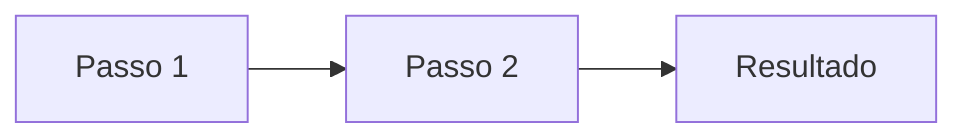

# Jornada: <nome>

## Gatilho e resultado
- **Começa quando:** <!-- ex: cliente toca em "Simular" -->
- **Termina quando:** <!-- ex: proposta criada / simulação exibida -->
- **Caminhos de saída:** <!-- desistência, reprovação, erro -->

## Passos

<!--
Um bloco por passo. Coloque só as regras CRÍTICAS: aquelas que, se o agente errar, quebram a resposta.
Toda regra precisa de origem.
-->

### 1. <Nome do passo>
- **O que acontece:** 
- **Componente(s):** [<nome>](../tecnico/04-mapa-componentes.md#<ancora>)
- **Regras:**
  - `RN-01` <regra> — *origem:* <normativo X / decisão PO em AAAA-MM / regulatório / legado / desconhecida>
- **Pode falhar com:** <!-- erros de negócio esperados e o que o cliente vê -->

### 2. <Nome do passo>
- **O que acontece:** 
- **Componente(s):** 
- **Regras:**
  - `RN-02` 
- **Pode falhar com:** 

## Diagrama (opcional)

## Ver também
- [Glossário](02-glossario.md)
- [Decisões e armadilhas](../tecnico/06-decisoes-armadilhas.md)
