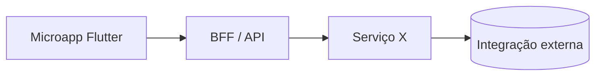

# Mapa de componentes

<!--
É o elo entre negócio e código. Não documente a implementação, porque isso o agente lê no repositório.
Documente o PAPEL de cada peça e ONDE ela está.
-->

## Visão geral

## Componentes

<!-- Um bloco por componente. A âncora (###) é o alvo dos links da jornada. -->

### <nome-do-componente>
- **Tipo:** microapp / BFF / serviço / rota Camel / integração externa / fila
- **Repositório:** `<org/repo>` — caminho relevante: `<path>`
- **Responsabilidade:** <!-- 1 ou 2 linhas -->
- **Atende passos da jornada:** [1](../negocio/03-jornada-principal.md#1-nome-do-passo), ...
- **Fala com:** <!-- quem chama / é chamado, sync ou async -->
- **Dono:** nosso squad / squad <X>
- **Contrato:** <!-- link pro OpenAPI / schema, se houver -->

### <outro-componente>
- **Tipo:** 
- **Repositório:** 
- **Responsabilidade:** 
- **Atende passos da jornada:** 
- **Fala com:** 
- **Dono:** 
- **Contrato:** 
